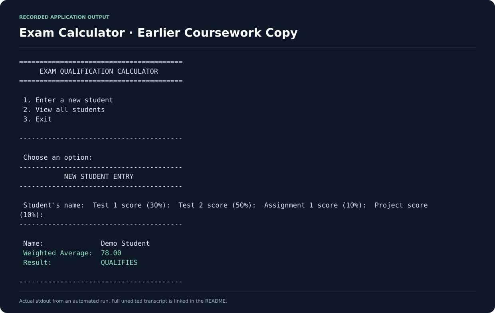

# Cloud Native Programming — Coursework Version

**Coursework · C# / .NET 10 · Docker**

This repository retains an earlier coursework copy of the student examination qualification calculator.

The [maintained portfolio version is ExamQualifier](https://github.com/Nkosinathi-bit/ExamQualifier). These repositories represent the same assignment, rather than two distinct applications.

## Output preview

The image below presents output recorded from a real automated application run. It is a console-output excerpt; the program uses a terminal interface.

[Full unedited output](docs/screenshots/console-output.txt) · [Capture source and sample input](docs/screenshots/capture.json)

## What the code does

- Captures a student's name and four integer assessment marks.
- Validates names, numeric input and the 0–100 mark range.
- Calculates a weighted average and checks the 50% qualification threshold.
- Holds captured results in memory for the current session.

| Assessment | Weight |
| --- | --- |
| Test 1 | 30% |
| Test 2 | 50% |
| Assignment 1 | 10% |
| Project | 10% |

## Run locally

Install the .NET 10 SDK:

~~~bash
dotnet run --project ExamQualifier.csproj
~~~

Or use Docker:

~~~bash
docker build -t cloud-native-coursework .
docker run --rm -it cloud-native-coursework
~~~

## Repository contents

Program.cs contains the menu, validation and calculations. ExamQualifier.csproj targets .NET 10. Dockerfile and .dockerignore define the container build. Automated container checks run through GitHub Actions.

There is no separate Student class, database or persistent storage in this implementation.

